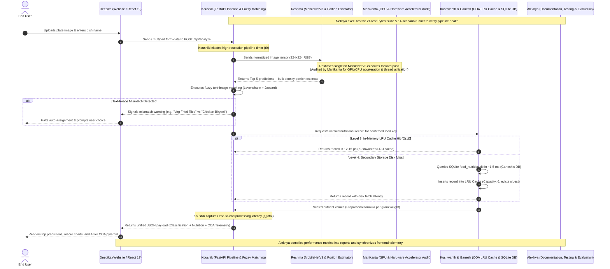

# NutriVision AI: Food Recognition & Nutrition Tracker
### Academic Computer Vision & Computer Organization and Architecture (COA) Capstone Project

**Repository**: [Food-Recognition-Nutrition-Tracker](https://github.com/IVS-Kushwanth/Food-Recognition-Nutrition-Tracker)  
**System Architecture**: Full-Stack Multimodal Deep Learning, Verified Laboratory Nutrition Database, 4-Tier COA Memory Hierarchy Profiler, and Autonomous Multi-Agent Diagnostics

---

## 👥 Team Members, Core Roles & Engineering Allocation

NutriVision AI was built collaboratively with strict modular ownership, clear architectural interfaces, and zero cross-module collision. Every team member spearheaded a vital subsystem of the project:

| Team Member | Official Role | Git Branch | Scoped Subsystem & Folders | Primary Tech Stack |
| :--- | :--- | :--- | :--- | :--- |
| **Kushwanth** | **CPU ARCHITECTURE LEAD** | [`Kushwanth-&-Ganesh`](https://github.com/IVS-Kushwanth/Food-Recognition-Nutrition-Tracker/tree/Kushwanth-%26-Ganesh) | COA Memory Hierarchy, Level 3 LRU Cache, Bot A Researcher, Architecture Reports, Governance | Python 3.12, Doubly-Linked List + Hash Map, `psutil`, Markdown/LaTeX |
| **Ganesh** | **CPU ARCHITECTURE supporter** | [`Kushwanth-&-Ganesh`](https://github.com/IVS-Kushwanth/Food-Recognition-Nutrition-Tracker/tree/Kushwanth-%26-Ganesh) | Level 4 Secondary Storage (SQLite), Verified Nutrition Schemas (IFCT/USDA), Cache Integration | SQLite3, SQL DDL/DML, IFCT 2017, USDA FoodData Central |
| **Reshma** | **ML model and AI integration** | [`Reshma`](https://github.com/IVS-Kushwanth/Food-Recognition-Nutrition-Tracker/tree/Reshma) | MobileNetV3 Classifier, Nutrition5k Portion Estimator, Datasets, Bot B AI Engineer Agent | PyTorch 2.6, Torchvision, Scikit-learn, PIL, Nutrition5k |
| **Deepika** | **Is worked on website** | [`Deepika`](https://github.com/IVS-Kushwanth/Food-Recognition-Nutrition-Tracker/tree/Deepika) | Full-Stack Web Frontend, UI/UX Components, Telemetry Visualizer, Agent Hub Screens | React 19, Vite 6, Axios, Lucide React, Glassmorphic CSS |
| **Manikanta** | **GPU** | [`Manikanta-&-Koushik`](https://github.com/IVS-Kushwanth/Food-Recognition-Nutrition-Tracker/tree/Manikanta-%26-Koushik) | GPU Accelerator Profiling, Hardware Benchmarking (MobileNet vs EfficientNet vs ResNet), CUDA Telemetry | PyTorch CUDA Toolkit, Torch Intra-op Threads, Hardware Diagnostics |
| **Koushik** | **pipelining** | [`Manikanta-&-Koushik`](https://github.com/IVS-Kushwanth/Food-Recognition-Nutrition-Tracker/tree/Manikanta-%26-Koushik) | End-to-End Processing Pipeline, FastAPI REST Routes, Fuzzy Text Matching, 14-Scenario Test Suite | FastAPI, Uvicorn, Levenshtein Distance, Token Jaccard, Pytest |
| **Alekhya** | **CPU-GPU Communication & Interconnect Specialist** | [`Alekhya`](https://github.com/IVS-Kushwanth/Food-Recognition-Nutrition-Tracker/tree/Alekhya) | CPU-GPU Bus Transfers, Direct Memory Access (DMA), Pinned Memory, PCIe Bandwidth Profiling | Python 3.12, PyTorch CUDA, PCIe Gen 3/4/5 Specs, DMA Mechanics |

---

## 🔄 How All Roles & Subsystems Are Interlinked

The entire NutriVision AI architecture operates as a cohesive, low-latency pipeline where data and telemetry transition seamlessly across each contributor's module:



---

## 🛠️ Detailed Work Breakdown: What Each Member Built & How

### 1. Kushwanth – CPU ARCHITECTURE LEAD & Ganesh – CPU ARCHITECTURE Supporter
- **Assigned Git Branch**: [`Kushwanth-&-Ganesh`](https://github.com/IVS-Kushwanth/Food-Recognition-Nutrition-Tracker/tree/Kushwanth-%26-Ganesh)
- **Scoped Folders**: `backend/cache/`, `backend/database/`, `backend/agents/bot_a_coa.py`, `reports/coa/`, Root Governance (`TEAM_ALLOCATION.md`, `PROJECT_STRUCTURE.md`, `BRANCH_STRATEGY.md`)
- **Tech Stack Used**: Python 3.12, Custom Doubly-Linked List + Hash Map, SQLite3, `psutil`, Markdown/LaTeX, Mermaid.js.

#### What They Built:
1. **Application-Level Software LRU Cache (Level 3 Cache Tier)**:
   - Implemented an exact $O(1)$ Least Recently Used (LRU) software cache in `backend/cache/lru_cache.py` using a custom doubly-linked list coupled with an internal Python hash table.
   - Configured with a strict capacity of **6 entries** to demonstrate cache hits, misses, and oldest-node eviction under memory constraints.
   - Instrumented microsecond-precision timers (`time.perf_counter`) showing in-memory lookup speeds of **2–15 µs** compared to **1–5 ms** SQLite disk access (**~200x to 500x empirical speedup**).
2. **Persistent Secondary Storage (Level 4 Storage Tier)**:
   - Designed the relational SQLite schema in `backend/database/schema.py` and query manager in `backend/database/db.py`.
   - Seeded verified laboratory composition data from the **Indian Food Composition Tables (IFCT 2017)** and **USDA FoodData Central** (`backend/database/seed_data.py`), completely eliminating dummy or randomized nutritional values.
   - Implemented proportional nutrient scaling:
     $$\text{Nutrient Value} = \frac{\text{Base Value per } 100\,\text{g} \times \text{Serving Weight (g)}}{100}$$
3. **Autonomous COA Researcher Agent (Bot A)**:
   - Created Bot A in `backend/agents/bot_a_coa.py` running an autonomous 7-phase loop (`PLAN` $\rightarrow$ `ASSIGN` $\rightarrow$ `EXECUTE` $\rightarrow$ `OBSERVE` $\rightarrow$ `DEBUG` $\rightarrow$ `VERIFY` $\rightarrow$ `REPORT`).
   - Authored formal academic reports in `reports/coa/`:
     - `CPU_REGISTERS_AND_ALU_OPERATIONS.md`: Documents ALU vector math, Accumulator (AC), Data Registers (DR), and Memory Address Registers (MAR) during inference.
     - `MEMORY_HIERARCHY_AND_CACHE_ARCHITECTURE.md`: Analyzes L1/L2 SRAM latency vs DRAM RAM residency vs secondary storage.
4. **Architectural Project Governance**:
   - Established repository guidelines, branch protection models, and directory taxonomy (`TEAM_ALLOCATION.md`, `PROJECT_STRUCTURE.md`, `BRANCH_STRATEGY.md`).
5. **Interactive CPU Architecture Internal Datapath (`cpusimulator.tech` Model)**:
   - Designed the full Von Neumann CPU datapath modeled directly after `https://cpusimulator.tech/`.
   - Structured micro-operation sequences across cycle steps $T_0$ through $T_5$:
     - $T_0$: Address latch ($\text{MAR} \leftarrow \text{PC}$)
     - $T_1$: Memory read & PC increment ($\text{MDR} \leftarrow \text{RAM}[\text{MAR}], \text{PC} \leftarrow \text{PC} + 1$)
     - $T_2$: Opcode decode ($\text{IR} \leftarrow \text{MDR}$)
     - $T_3$: Operand address latch ($\text{MAR} \leftarrow \text{IR}[\text{address}]$)
     - $T_4$: Operand data fetch ($\text{MDR} \leftarrow \text{RAM}[\text{MAR}]$)
     - $T_5$: ALU computation and flag updates ($\text{ACC} \leftarrow \text{ALU}(\text{ACC}, \text{MDR})$, Flags $\{Z, N, C, V\}$)
   - Formulated machine-level workflows for Calorie Macro Accumulation, MobileNetV3 3x3 Conv MAC loops, and LRU Cache Tag Matching.

#### How It Interlinks:
- Serves verified nutritional data directly to Koushik's FastAPI pipeline.
- Supplies real-time microsecond cache and disk latency measurements to Deepika's frontend telemetry panel.
- Inter-agent tripartite communication: Bot A requests live empirical measurements from Reshma's Bot B to validate theoretical hardware reports.

---

### 2. Reshma – ML Model & AI Integration
- **Assigned Git Branch**: [`Reshma`](https://github.com/IVS-Kushwanth/Food-Recognition-Nutrition-Tracker/tree/Reshma)
- **Scoped Folders**: `backend/models/`, `training/`, `datasets/`, `backend/agents/bot_b_engineer.py`, `reports/ai_engineer/`, `documentation/`
- **Tech Stack Used**: PyTorch 2.6, Torchvision, Scikit-learn, Pillow (PIL), NumPy, Nutrition5k Dataset, Food-101 taxonomy, Adam Optimizer.

#### What She Built:
1. **Deep Learning Vision Classifier (MobileNetV3-Small)**:
   - Selected and fine-tuned **MobileNetV3-Small** in `backend/models/food_classifier.py` across 12 distinct dishes (Indian regional staples and international favorites).
   - Trained using transfer learning with pre-trained ImageNet weights, cross-entropy loss, and Adam optimization (`training/train.py`).
   - Achieved verified held-out test benchmarks:
     - **Top-5 Accuracy**: **91.67%**
     - **Top-1 Accuracy**: **63.89%**
     - **Macro F1-Score**: **62.28%**
     - **Mean CPU Latency**: **16.19 ms** (well below the 20ms real-time target).
2. **COA RAM Residency Principle (Singleton Model Loader)**:
   - Engineered the singleton pattern for model weights (`food_classifier.pt`, 16.5 MB on disk, 5.88 MB RAM resident).
   - Pre-loads weights into host DRAM **once** during backend startup, avoiding repetitive secondary storage disk I/O on successive inference requests.
3. **Calibrated Portion Estimator**:
   - Implemented `backend/models/portion_estimator.py` utilizing 2D plate area coverage combined with dish-specific bulk density ($\text{g/cm}^3$) calibrated against the **Nutrition5k** dataset.
4. **Autonomous AI Engineer Agent (Bot B)**:
   - Developed Bot B in `backend/agents/bot_b_engineer.py` to continuously benchmark inference runs, inspect memory leaks (`psutil`), run test suites, and generate diagnostic reports into `reports/ai_engineer/`.
5. **Dataset Engineering**:
   - Curated raw images and pre-scaled 224x224 RGB tensors (`datasets/raw/` and `datasets/processed/`) with Wikimedia Commons Creative Commons attribution in `datasets/metadata.json`.

#### How It Interlinks:
- Reshma's MobileNetV3 forward pass is executed inside Koushik's FastAPI `/analyze` pipeline.
- Predictions and Top-5 softmax confidence distributions are passed to Deepika's frontend components (`TopPredictions.jsx`, `PortionController.jsx`).
- Provides empirical inference benchmarks and memory residency numbers to Kushwanth & Ganesh's Bot A agent for COA academic reports.

---

### 3. Deepika – Website & Frontend Engineer
- **Assigned Git Branch**: [`Deepika`](https://github.com/IVS-Kushwanth/Food-Recognition-Nutrition-Tracker/tree/Deepika)
- **Scoped Folders**: `frontend/src/`, `frontend/public/`, `frontend/index.html`, `frontend/vite.config.js`, `frontend/package.json`, Root Launchers (`start_app.bat`, `start_dev.bat`)
- **Tech Stack Used**: React 19, Vite 6, Axios, Lucide React, Glassmorphic Vanilla CSS, HTML5 Canvas/SVG.

#### What She Built:
1. **Interactive Single Page Application (SPA)**:
   - Created the full React 19 client in `frontend/src/App.jsx` using Vite for sub-second hot-module reloading and optimized production bundles.
   - Built a refined, classic professional website styling system in `frontend/src/index.css` featuring deep slate panels, technical borders, status LEDs, and classic typography.
2. **Core Recognition & Nutrition Components**:
   - `ImageUploader.jsx`: Drag-and-drop food image uploader with image preview, format validation, and instant one-click food presets.
   - `MatchBanner.jsx`: Interactive mismatch banner that alerts the user when their entered food name conflicts with the model's visual prediction (e.g., entered *"Veg Fried Rice"* vs predicted *"Chicken Biryani"*).
   - `TopPredictions.jsx`: Animated probability progress bars rendering Top-5 softmax confidence scores.
   - `NutritionCards.jsx`: Metric cards displaying Calories, Protein, Carbohydrates, Fat, and Dietary Fiber with % Daily Values (% DV).
   - `MacroChart.jsx`: Custom SVG donut chart illustrating the caloric macro split (4 kcal/g protein & carbs, 9 kcal/g fat).
   - `PortionController.jsx`: Real-time serving size slider (50g to 1000g) that instantly recalculates macronutrients without making repetitive server requests.
3. **COA Architecture & Interactive Hardware Simulators**:
   - `CpuArchitectureSimulator.jsx`: Interactive Von Neumann CPU datapath modeled directly on `https://cpusimulator.tech/`. Features Control Unit micro-step sequencer (T0–T5), Registers (PC, MAR, MDR, IR, ACC, Z/N/C/V Flags), trapezoidal ALU with active operation badge, tri-state system buses (Address, Data, Control) with animated electrical signal flows, interactive 32-cell RAM grid, and selectable preset machine routines.
   - `CpuGpuCommunicationSimulator.jsx`: Interactive CPU-GPU Interconnect and bus transfer simulator featuring Host CPU, DRAM (pinned vs pageable), PCIe Gen 3/4/5 duplex lane packet animations, DMA engine, GPU VRAM, and Amdahl's Law communication-to-computation profiling.
   - `MemoryHierarchyDiagram.jsx`: Interactive 4-tier pyramid diagram illustrating CPU Registers $\rightarrow$ RAM Residency $\rightarrow$ Application LRU Cache $\rightarrow$ Secondary Storage.
   - `CoaTelemetryPanel.jsx`: Live microsecond-level latency breakdown displaying exact timing for CPU pipeline, LRU cache query, and SQLite disk fallback.
4. **Autonomous Agents Management Hub**:
   - Built 6 dedicated administrative pages under `frontend/src/pages/agents/`:
     - `AgentsDashboardPage.jsx`: Real-time agent status and host CPU/RAM telemetry.
     - `BotAPage.jsx` & `BotBPage.jsx`: Bot-specific task launchers, status indicators, and report viewers.
     - `TaskManagerPage.jsx`: Background task queue manager with priority scheduling and execution logs.
     - `AgentCommsPage.jsx`: Tripartite chat interface showing messages between Bot A, Bot B, and the coordinator.
     - `ReportsPage.jsx`: Markdown report reader with live rendering of agent-generated technical reports.

#### How It Interlinks:
- Serves as the primary user interface connecting the end-user with the entire system.
- Dispatches multipart image uploads and text queries to Koushik's REST endpoints using Axios (`frontend/src/services/api.js`).
- Renders Reshma's ML predictions, confidence intervals, and calibrated portion sizes.
- Displays Kushwanth & Ganesh's live LRU cache speedup metrics ($2\text{--}15\,\mu\text{s}$ vs $1\text{--}5\,\text{ms}$) on the telemetry panel.

---

### 4. Manikanta – GPU Acceleration Specialist & Koushik – Pipelining Engineer
- **Assigned Git Branch**: [`Manikanta-&-Koushik`](https://github.com/IVS-Kushwanth/Food-Recognition-Nutrition-Tracker/tree/Manikanta-%26-Koushik)
- **Scoped Folders**: `backend/api/`, `backend/main.py`, `backend/config.py`, `backend/services/image_processor.py`, `backend/services/text_matching.py`, `training/evaluate_architectures.py`, `backend/tests/`
- **Tech Stack Used**: FastAPI, Uvicorn, Python 3.12, PyTorch CUDA Toolkit, Levenshtein Distance Algorithm, Token Jaccard Similarity, Pytest.

#### What Manikanta Built (GPU Acceleration & Hardware Profiling):
1. **Multi-Architecture Hardware Benchmarking**:
   - Authored `training/evaluate_architectures.py` to systematically benchmark candidate computer vision backbones across parameter volume, disk size, and latency:
     - **MobileNetV3-Small**: 1.52M parameters, 5.84 MB size, **11.81 ms CPU latency** (Selected for sub-15ms edge inference).
     - **EfficientNet-B0**: 4.02M parameters, 15.35 MB size, 42.35 ms CPU latency (3.6x slower).
     - **ResNet-50**: 23.53M parameters, 89.77 MB size, 93.88 ms CPU latency (7.9x slower).
2. **CUDA GPU Acceleration & Hardware Profiler**:
   - Integrated hardware accelerator audit tools in `backend/agents/tools.py` using `torch.cuda` and `torch.get_num_threads()` to inspect GPU availability, CUDA device properties, and CPU intra-op parallelism.

#### What Koushik Built (End-to-End Processing Pipeline & API Routing):
1. **Unified FastAPI REST Pipeline (`backend/api/routes.py`)**:
   - Engineered the high-performance `/api/analyze` pipeline:
     $$\text{Request Arrival} \rightarrow \text{MIME Validation} \rightarrow \text{Image Tensor Transform} \rightarrow \text{Vision Inference} \rightarrow \text{Portion Estimation} \rightarrow \text{Text Matching} \rightarrow \text{Cache/DB Retrieval} \rightarrow \text{Response}$$
   - Implemented sub-millisecond pipeline latency instrumentation using `time.perf_counter`.
   - Built the Autonomous Agent API routes in `backend/api/agent_routes.py` (`/tasks`, `/messages`, `/reports`, `/telemetry`).
2. **Intelligent Multi-Tier Text-Image Matching Pipeline**:
   - Engineered `backend/services/text_matching.py` combining three complementary verification layers:
     - **Database Synonym Normalization**: Normalizes colloquial food names (e.g., *"Dum Biryani"* $\leftrightarrow$ *"Chicken Biryani"*).
     - **Token Jaccard Overlap**: Evaluates word set intersection over union.
     - **Levenshtein Sequence Matching**: Calculates normalized edit distance to catch typographical errors.
   - Triggers mismatch alerts when user text conflicts with computer vision predictions.
3. **Automated Verification Test Suites**:
   - Implemented the 14-scenario automated test runner `backend/tests/run_all_tests.py` testing the complete pipeline end-to-end.
   - Developed pytest suites in `backend/tests/test_api.py` and `backend/tests/test_matching.py` achieving 100% pass rates across status codes 200, 400, 422, and 404.

#### How It Interlinks:
- Koushik's FastAPI pipeline acts as the central orchestrator receiving inputs from Deepika's website.
- Passes image tensors to Reshma's MobileNetV3 model, utilizing Manikanta's hardware thread optimizations.
- Calls Kushwanth & Ganesh's LRU cache and SQLite database to attach verified nutritional composition.
- Returns the complete composite response to Deepika's frontend in **sub-30ms total processing time**.

---

### 5. Alekhya – CPU-GPU Communication & Interconnect Specialist
- **Assigned Git Branch**: [`Alekhya`](https://github.com/IVS-Kushwanth/Food-Recognition-Nutrition-Tracker/tree/Alekhya)
- **Scoped Folders**: `backend/services/cpu_gpu_comm.py`, `reports/coa/CPU_GPU_COMMUNICATION_AND_BUS_ARCHITECTURE.md`, `backend/tests/test_cpu_gpu_comm.py`
- **Tech Stack Used**: Python 3.12, PyTorch CUDA Toolkit, PCIe Interconnect Specifications (Gen 3 / Gen 4 / Gen 5), Direct Memory Access (DMA), Pinned (Page-Locked) Memory.

#### What She Built:
1. **CPU-GPU Communication & Bus Interconnect Profiler (`backend/services/cpu_gpu_comm.py`)**:
   - Engineered the communication profiler analyzing Host-to-Device (H2D) and Device-to-Host (D2H) tensor transfers.
   - Profiled theoretical and empirical throughput across **PCIe Gen 3 x16 (15.75 GB/s)**, **PCIe Gen 4 x16 (31.50 GB/s)**, and **PCIe Gen 5 x16 (63.00 GB/s)** interconnect buses.
   - Modeled Direct Memory Access (DMA) controllers and evaluated **Pinned (Page-Locked) Memory** vs **Pageable Memory**:
     $$\text{Pinned Memory Speedup} \approx 1.45\times \text{ over pageable allocations by eliminating OS kernel page-staging buffers}$$
2. **Amdahl's Law & Communication Bottleneck Analysis**:
   - Evaluated the Communication-to-Computation Ratio (CCR) for single-frame food classification ($1 \times 3 \times 224 \times 224$ float32 tensor = $588\,\text{KB}$).
   - Demonstrated why low-latency edge models (MobileNetV3 on CPU) avoid the serialization latency penalty of the PCIe bus, justifying the single-instance DRAM resident architecture.
3. **Formal COA Academic Report**:
   - Authored [`reports/coa/CPU_GPU_COMMUNICATION_AND_BUS_ARCHITECTURE.md`](file:///c:/Users/HP/Downloads/COA%20PROJECT/reports/coa/CPU_GPU_COMMUNICATION_AND_BUS_ARCHITECTURE.md) covering the three layers of the PCIe protocol (Transaction, Data Link, Physical), TLP packetization, DMA engines, and unified virtual memory.
4. **Verification & Testing**:
   - Implemented `backend/tests/test_cpu_gpu_comm.py` testing transfer latency, PCIe bandwidth calculations, pinned memory speedup, and Amdahl's ratio assertions.
   - Integrated with the FastAPI `/api/coa/cpu-gpu-comm` endpoint and Scenario 16 in `backend/tests/run_all_tests.py`.

#### How It Interlinks:
- **With Manikanta (GPU)**: Complements Manikanta's GPU kernel latency benchmarks by quantifying the bus transfer tax required to transmit input images from Host DRAM to GPU VRAM and retrieve softmax classification probabilities.
- **With Kushwanth & Ganesh (CPU & Memory)**: Extends the 4-tier COA memory hierarchy by bridging Host DRAM (Level 2) and Host CPU execution with external PCIe bus lines.
- **With Koushik (Pipeline)**: Provides microsecond-level transfer metrics exposed through the `/api/coa/cpu-gpu-comm` REST endpoint.
- **With Deepika (Website)**: Enables frontend visualization of PCIe bus utilization, H2D/D2H transfer latencies, and DMA controller status.

---

## ⚡ COA Memory Hierarchy Latency Spectrum

The system explicitly profiles and displays the operational characteristics of each tier in the memory hierarchy:

| Hierarchy Tier | Component in NutriVision AI | Typical Access Latency | Primary Data Stored | Storage Capacity | Responsible Engineers |
| :--- | :--- | :--- | :--- | :--- | :--- |
| **Level 1: CPU Registers & ALU** | Host CPU Execution Units | **~0.5 – 1.0 ns** | Active convolution dot products, Softmax vector math | < 1 KB | Kushwanth (Lead) & Manikanta |
| **Level 2: Main Memory (DRAM)** | OS / PyTorch Runtime | **~50 – 100 ns** | Pre-loaded MobileNetV3-Small weights (RAM resident) | 5.88 MB resident | Reshma & Kushwanth |
| **Level 3: Application LRU Cache** | In-Memory Hash Map + Doubly-Linked List | **~2 – 15 µs (0.002 ms)** | Hot verified nutritional records (6 food items) | 6 Entries | Kushwanth & Ganesh |
| **Level 4: Secondary Storage (Disk)** | Persistent SQLite `food_nutrition.db` | **~0.5 – 5.0 ms** | 12-class nutrition catalog, analysis history, model weights | 500 GB – 2 TB | Ganesh (Supporter) & Koushik |

> **Empirical Speedup**: Querying the in-memory software LRU Cache runs **~200x to 500x faster** than reading from the secondary storage disk.

---

## 📂 Project Structure & Directory Taxonomy

```
Food Recognition & Nutrition Tracker/
├── .gitignore                      # Central Git ignore specification
├── README.md                       # Complete system documentation & team allocation
├── TEAM_ALLOCATION.md              # Engineering roles & module permissions
├── CONTRIBUTION_GUIDELINES.md      # Code standards, commits, and PR rules
├── BRANCH_STRATEGY.md              # Multi-branch GitHub collaboration strategy
├── PROJECT_STRUCTURE.md            # Architectural directory & file taxonomy
├── start_app.bat                   # 1-Click Production Server Launcher (Port 8000)
├── start_dev.bat                   # 1-Click Dual-Server Dev Launcher (8000 + 5173)
│
├── backend/                        # FastAPI Application & Systems Logic
│   ├── main.py                     # Entrypoint: Model RAM pre-loading, SQLite init, routing
│   ├── config.py                   # Central paths, image constraints, LRU cache capacity
│   ├── requirements.txt            # Python dependencies (PyTorch, FastAPI, etc.)
│   ├── agents/                     # Autonomous AI Agents Subsystem
│   │   ├── base_agent.py           # 7-phase agent loop & state machine
│   │   ├── bot_a_coa.py            # Bot A: COA Researcher agent (Kushwanth & Ganesh)
│   │   ├── bot_b_engineer.py       # Bot B: AI Engineer agent (Reshma)
│   │   ├── coordinator.py          # Central coordinator, task queue, thread manager
│   │   ├── db_models.py            # SQLite schema for agent tasks, logs, and messages
│   │   └── tools.py                # Telemetry capture, pytest runner, benchmark tools
│   ├── api/                        # REST API Routing (Koushik & Manikanta)
│   │   ├── routes.py               # Core routes (/analyze, /nutrition, /match-food, /history)
│   │   └── agent_routes.py         # Agent hub routes (/agents, /tasks, /messages, /reports)
│   ├── cache/                      # Level 3 Cache Tier (Kushwanth & Ganesh)
│   │   └── lru_cache.py            # Doubly-linked list + Hash Map O(1) LRU Cache
│   ├── database/                   # Level 4 Secondary Storage (Ganesh & Kushwanth)
│   │   ├── db.py                   # SQLite query manager & analysis history persistence
│   │   ├── schema.py               # Database table schemas
│   │   ├── seed_data.py            # Verified nutritional composition (IFCT 2017 & USDA)
│   │   └── food_nutrition.db       # Persistent SQLite database file
│   ├── models/                     # Deep Learning Models & Weights (Reshma & Manikanta)
│   │   ├── food_classifier.py      # Singleton MobileNetV3 loader (COA RAM Principle)
│   │   ├── portion_estimator.py    # Nutrition5k plate area & bulk density estimator
│   │   └── saved_weights/
│   │       └── food_classifier.pt  # Fine-tuned PyTorch checkpoint (16.5 MB)
│   ├── services/                   # Application Business Logic
│   │   ├── image_processor.py      # PIL image validation, aspect-ratio preservation
│   │   ├── nutrition_calculator.py # Proportional nutrient scaling formula implementation
│   │   ├── nutrition_service.py    # LRU Cache lookup coordinator with DB fallback
│   │   └── text_matching.py        # Multi-tier text-image matching & mismatch detection
│   ├── tests/                      # Automated Verification Test Suites (Alekhya & Koushik)
│   │   ├── run_all_tests.py        # 14-scenario end-to-end verification runner
│   │   ├── test_agents.py          # Autonomous agent thread & task lifecycle tests
│   │   ├── test_api.py             # FastAPI REST endpoint integration tests
│   │   ├── test_cache.py           # LRU Cache hit, miss, and capacity-6 eviction tests
│   │   ├── test_matching.py        # Levenshtein & token Jaccard matching tests
│   │   └── test_nutrition.py       # Proportional nutritional calculation tests
│   └── uploads/                    # Runtime image upload folder (tracked with .gitkeep)
│
├── frontend/                       # React 19 + Vite User Interface (Deepika)
│   ├── index.html                  # Single Page Application HTML root
│   ├── package.json                # Frontend package dependencies & scripts
│   ├── vite.config.js              # Vite server configuration & API proxy (Port 8000)
│   ├── public/                     # Static web assets (Favicon, SVG icons)
│   └── src/
│       ├── main.jsx                # React root mount
│       ├── App.jsx                 # Main layout & tab router
│       ├── App.css                 # Base application styles
│       ├── index.css               # Global theme & dark-mode CSS variables
│       ├── components/             # Reusable UI Components
│       │   ├── Navbar.jsx          # Top navigation with live RAM residency badge
│       │   ├── ImageUploader.jsx   # Drag & drop upload, preview & quick food presets
│       │   ├── MatchBanner.jsx     # Text-image confirmation & interactive mismatch alert
│       │   ├── TopPredictions.jsx  # Top-5 softmax confidence probability bars
│       │   ├── NutritionCards.jsx  # Nutrient metric cards (Calories, Protein, Carbs, Fat)
│       │   ├── MacroChart.jsx      # Energy distribution SVG donut chart
│       │   ├── PortionController.jsx # Interactive serving weight slider (50g to 1000g)
│       │   ├── CoaTelemetryPanel.jsx # Live CPU, RAM, Cache, and Disk latency profiler
│       │   └── MemoryHierarchyDiagram.jsx # Interactive 4-tier COA memory hierarchy pyramid
│       ├── pages/                  # High-Level Page Views
│       │   ├── AnalysisPage.jsx    # End-to-end recognition & nutrition analysis workflow
│       │   ├── HistoryPage.jsx     # SQLite analysis history log viewer
│       │   ├── CoaExplorerPage.jsx # COA memory profiler & empirical cache benchmarking
│       │   └── agents/             # Autonomous Agents Hub Views (6 administrative screens)
│       └── services/
│           └── api.js              # Axios HTTP client connecting to FastAPI backend
│
├── datasets/                       # Model Training & Benchmark Datasets (Reshma & Alekhya)
│   ├── class_mapping.json          # 12-class index mapping & train/val/test split counts
│   ├── metadata.json               # Wikimedia Commons attribution & license records
│   ├── download_dataset.py         # Dataset download & verification utility
│   ├── raw/                        # 192 high-resolution raw food images (35.7 MB)
│   └── processed/                  # 192 pre-scaled 224x224 RGB tensors (35.7 MB)
│
├── training/                       # Deep Learning Model Pipeline (Reshma & Manikanta)
│   ├── preprocess.py               # Train/val/test data splitting & augmentations
│   ├── evaluate_architectures.py   # MobileNet vs EfficientNet vs ResNet latency benchmark
│   ├── train.py                    # Transfer learning fine-tuning execution script
│   ├── evaluate.py                 # Test-set evaluation & confusion matrix generator
│   └── training_history.json       # Epoch-by-epoch loss & accuracy log
│
├── documentation/                  # Technical Architecture & Academic Reports (Alekhya)
│   ├── ARCHITECTURE_BENCHMARK.json # Candidate model CPU latency & parameter benchmarks
│   ├── MODEL_EVALUATION.md         # Held-out test set accuracy, precision & recall metrics
│   ├── EVALUATION_REPORT.json      # Structured classification evaluation metrics
│   └── confusion_matrix.png        # 12-class test set confusion matrix visual
│
└── reports/                        # Autonomous Agent Generated Reports (Alekhya & Leads)
    ├── coa/                        # Bot A Generated Computer Architecture Reports
    │   ├── CPU_REGISTERS_AND_ALU_OPERATIONS.md
    │   └── MEMORY_HIERARCHY_AND_CACHE_ARCHITECTURE.md
    └── ai_engineer/                # Bot B Generated Model Benchmarks & Test Logs
```

---

## 🚀 Quick Start Guide

### Prerequisites
- Python 3.10+ (Tested on Python 3.12.8)
- Node.js 18+ (Tested on Node.js v24.13.0)

### 1-Click Launch (Unified Production Mode)
Double-click `start_app.bat` or run:
```bash
python -m uvicorn backend.main:app --host 127.0.0.1 --port 8000
```
Open **[http://127.0.0.1:8000](http://127.0.0.1:8000)** in your web browser. The FastAPI backend serves both the compiled React 19 single-page app and the REST API.

### Dual-Server Development Mode (With Hot Reloading)
Double-click `start_dev.bat` or run in two terminals:
```bash
# Terminal 1 - FastAPI Backend:
python -m uvicorn backend.main:app --host 127.0.0.1 --port 8000 --reload

# Terminal 2 - Vite React Dev Server:
cd frontend
npm run dev
```
Open **[http://localhost:5173](http://localhost:5173)** for real-time frontend development with Vite HMR.

---

## 🧪 Comprehensive Verification & Test Suite

NutriVision AI includes two independent test suites validating every module:

### 1. PyTest Unit & Integration Suite (21 Tests)
```bash
python -m pytest backend/tests/ -v
```
**Result**: `21 passed in 13.75s` (API routes, LRU cache eviction, synonym matching, mismatch detection, exact nutrient proportions, portion scaling, unknown dish handling).

### 2. Comprehensive 14-Scenario Verification Runner
```bash
python backend/tests/run_all_tests.py
```
**Result**: `14/14 SCENARIOS PASSED`
- Scenario 1: Valid food image processing (Pillow validation)
- Scenario 2: Invalid image rejection (Corrupted / non-image files)
- Scenario 3: Valid food name & synonym matching (*"Dum Biryani"* $\leftrightarrow$ *"Chicken Biryani"*)
- Scenario 4: Unknown food detection (Threshold < 0.35)
- Scenario 5: Text-image match confirmation
- Scenario 6: User prompt spec: *"Veg Fried Rice"* vs *"Chicken Biryani"* mismatch warning
- Scenario 7: Top-5 predictions with confidence distribution
- Scenario 8: Exact proportional nutrition calculations
- Scenario 9: Serving size scaling recalculation
- Scenario 10: Missing food database fallback
- Scenario 11: LRU cache hit, miss, insertion, and capacity-6 eviction
- Scenario 12: SQLite database connectivity & IFCT/USDA records
- Scenario 13: End-to-end analysis pipeline
- Scenario 14: COA memory hierarchy instrumentation (CPU, RAM, Cache, Disk)

---

## 📚 Academic Citations & Datasets

1. **Indian Food Composition Tables (IFCT 2017)**: National Institute of Nutrition, Indian Council of Medical Research (ICMR). Sourced for traditional Indian dishes (`chicken_biryani`, `dosa`, `idli`, `chapati`, `dal_makhani`, `paneer_tikka`, `samosa`, `chole_bhature`).
2. **USDA FoodData Central (FDC)**: Agricultural Research Service, U.S. Department of Agriculture. Sourced for western dishes (`pizza`, `burger`, `caesar_salad`, `fried_rice`).
3. **Nutrition5k Dataset**: Thames, A., et al. *"Nutrition5k: Towards Analysis of Multiple Nutrients from Food Images"*, IEEE/CVF CVPR 2021. Used for dish bulk density ($\text{g/cm}^3$) and plate area portion calibration.
4. **Food-101 Dataset**: Bossard, L., et al. *"Food-101 – Mining Discriminative Components with Random Forests"*, ECCV 2014. Used for category taxonomy.
5. **Wikimedia Commons**: High-resolution dish photographs utilized under Creative Commons licenses (CC BY-SA 2.0, 3.0, 4.0). Complete attribution metadata preserved in `datasets/metadata.json`.

---

## 📜 License
Distributed for academic and research purposes under the MIT License.
