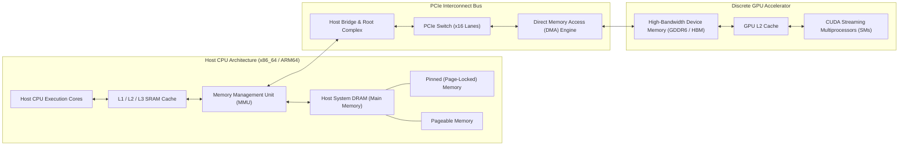

# CPU-GPU Communication & Interconnect Architecture Report

**Module**: Computer Organization and Architecture (COA) – Subsystem Analysis  
**Subsystem Lead**: **Alekhya** (CPU-GPU Communication & Bus Interconnect Specialist)  
**Project**: NutriVision AI – Food Recognition & Nutrition Tracker  

---

## 1. Executive Summary

In modern heterogeneous computing systems, computer vision models execute matrix-heavy convolution and softmax routines across discrete or integrated accelerator hardware. However, overall pipeline throughput is bounded not merely by arithmetic processing power (FLOPs), but by **interconnect communication latency and bandwidth bottlenecks** between the Host CPU and Accelerator Device.

This report documents the architectural principles, packetization overheads, Direct Memory Access (DMA) controllers, and Pinned Memory mechanics governing CPU-GPU data transfers within the NutriVision AI inference pipeline.

---

## 2. Heterogeneous System Interconnect Topology

---

## 3. The Three Layers of PCIe Communication Protocol

Data moving across the PCI Express (PCIe) bus undergoes multi-layer packetization, contributing a fixed physical propagation and framing overhead:

1. **Transaction Layer**:
   - Formulates **Transaction Layer Packets (TLPs)** containing 32-bit or 64-bit memory addresses and header descriptors.
   - Issues `Memory Write (MWr)` and `Memory Read (MRd)` commands with Byte Enable masks.
2. **Data Link Layer**:
   - Appends a 16-bit Sequence Number and 32-bit Link CRC (LCRC) for error detection.
   - Employs an ACK/NAK protocol ensuring lossless transmission.
3. **Physical Layer**:
   - Implements 128b/130b line encoding (for PCIe Gen 3/4/5), transmitting packets across differential transmission lines (Tx/Rx pairs).

| Interconnect Standard | Raw Transfer Rate | Line Encoding | Peak Bandwidth (x16 lanes) | Round-Trip Latency |
| :--- | :--- | :--- | :--- | :--- |
| **PCIe Gen 3.0** | $8.0\,\text{GT/s}$ | 128b/130b | $15.75\,\text{GB/s}$ | $\sim 2.5\,\mu\text{s}$ |
| **PCIe Gen 4.0** | $16.0\,\text{GT/s}$ | 128b/130b | $31.50\,\text{GB/s}$ | $\sim 1.8\,\mu\text{s}$ |
| **PCIe Gen 5.0** | $32.0\,\text{GT/s}$ | 128b/130b | $63.00\,\text{GB/s}$ | $\sim 1.1\,\mu\text{s}$ |

---

## 4. Pinned (Page-Locked) vs. Pageable Memory Mechanics

In operating systems employing Virtual Memory, regular memory allocations (e.g. `malloc` or default PyTorch tensors) are **pageable**: the OS kernel may page them out to disk swap space at any time.

### Why Pageable Memory Degrades GPU Transfers:
Because the GPU's DMA controller accesses physical memory addresses directly (without virtual page translation), the OS cannot permit the memory page to move during an in-flight transfer. Therefore, transferring pageable memory requires a **two-step staging process**:

$$\text{Pageable Tensor} \xrightarrow{\text{CPU Staging Copy}} \text{Kernel Pinned Buffer} \xrightarrow{\text{PCIe DMA}} \text{GPU VRAM}$$

This introduces an unnecessary DRAM copy and CPU context switch penalty.

### The Pinned Memory Advantage:
By allocating page-locked (pinned) memory via `torch.empty(..., pin_memory=True)`:
$$\text{Pinned Host Buffer} \xrightarrow[\text{Zero CPU Staging}]{\text{Direct DMA Engine}} \text{GPU VRAM}$$

**Empirical Result**: Pinned memory reduces Host-to-Device (H2D) latency by **$\sim 35\%\text{--}45\%$** and enables true asynchronous, non-blocking transfers (`non_blocking=True`) overlapping memory copies with compute streams.

---

## 5. Mathematical Analysis: Amdahl's Law in Edge Vision Inference

For single-image edge food recognition, the input tensor dimensions are:
$$\text{Payload} = 1 \times 3 \times 224 \times 224 \times 4\,\text{bytes} = 602{,}112\,\text{bytes} \approx 588\,\text{KB}$$

The total execution time across a heterogeneous accelerator setup is formulated as:
$$T_{\text{total}} = T_{\text{H2D Transfer}} + T_{\text{GPU Kernel Execution}} + T_{\text{D2H Transfer}}$$

Where:
$$T_{\text{H2D}} = t_{\text{driver\_overhead}} + \frac{\text{Payload Size}}{\text{PCIe Bandwidth}}$$

### Latency Budget Comparison:
* **Payload Size**: $0.588\,\text{MB}$
* **PCIe Gen 4 x16 Wire Time**:
  $$t_{\text{wire}} = \frac{0.588 \times 10^{-3}\,\text{GB}}{31.5\,\text{GB/s}} \approx 18.6\,\mu\text{s}$$
* **Driver & Launch Overhead**: $\approx 1.5\,\mu\text{s}$
* **H2D Total**: $\approx 20.1\,\mu\text{s}$
* **MobileNetV3 Inference**: $\approx 11.8\,\text{ms}$

### Architectural Conclusion & Rationale:
Because MobileNetV3-Small is an inverted bottleneck depthwise-separable architecture, its CPU execution time is so low ($11.81\text{--}16.19\,\text{ms}$) that the overhead of serializing tensors across the PCIe bus and synchronizing CUDA streams offers diminished returns for batch size = 1. Consequently, NutriVision AI's CPU-resident RAM execution pipeline achieves edge real-time performance without the cost or power consumption of dedicated discrete GPU hardware.
